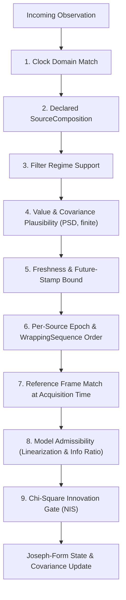

# Chapter 4: Bayesian Filtering and the Admission Funnel

A recursive Bayesian filter maintains a probability distribution over the vehicle state $\mathbf{x}_k$ at step $k$. When the dynamics and measurement models are linear (or locally linearized) with Gaussian noise, the Kalman filter updates the state estimate $\hat{\mathbf{x}}$ and its error covariance $\mathbf{P}$. In real operations, sensors also emit corrupted packets, out-of-range variances, stale timestamps, and physical outliers. `navigate-fusion` places a nine-stage admission funnel in front of the Kalman update so that bad data cannot corrupt the state (ADR-0003, ADR-0012, ADR-0014).

## Technical names

- **Innovation** (or measurement residual) $\mathbf{y}$ is the difference between a measured value $\mathbf{z}$ and the value $\mathbf{h}(\hat{\mathbf{x}}^-)$ predicted from the propagated state.
- **Innovation covariance** $\mathbf{S}$ is the sum of the projected state covariance $\mathbf{H}\mathbf{P}^-\mathbf{H}^\top$ and the measurement noise covariance $\mathbf{R}$.
- **Normalized Innovation Squared (NIS)** is the scalar Mahalanobis distance squared $\gamma = \mathbf{y}^\top \mathbf{S}^{-1} \mathbf{y}$.
- **Information ratio** $\eta$ is the dimensionless ratio of prior state variance along a measurement gradient to measurement noise variance.

## The discrete Kalman recursion and Joseph-form update

Between measurements, a propagator advances the state estimate $\hat{\mathbf{x}}_{k-1}^+ \to \hat{\mathbf{x}}_k^-$ and propagates the covariance with the state transition matrix $\boldsymbol{\Phi}_k$ and discrete process noise $\mathbf{Q}_k$:

$$\mathbf{P}_k^- = \boldsymbol{\Phi}_k \mathbf{P}_{k-1}^+ \boldsymbol{\Phi}_k^\top + \mathbf{Q}_k$$

For a six-state kinematic filter (`NavigationFilter`), the state vector in the local NED tangent plane is:

$$\mathbf{x} = \begin{bmatrix} p_N & p_E & p_D & v_N & v_E & v_D \end{bmatrix}^\top$$

and `ConstantVelocityPropagator` uses constant-velocity kinematics driven by white acceleration spectral density.

When a measurement $\mathbf{z}_k \in \mathbb{R}^m$ with linearized Jacobian $\mathbf{H}_k = \partial \mathbf{h}/\partial \mathbf{x}$ and covariance $\mathbf{R}_k$ arrives, the filter computes the innovation and Kalman gain:

$$\begin{aligned} \mathbf{y}_k &= \mathbf{z}_k - \mathbf{h}(\hat{\mathbf{x}}_k^-) \\ \mathbf{S}_k &= \mathbf{H}_k \mathbf{P}_k^- \mathbf{H}_k^\top + \mathbf{R}_k \\ \mathbf{K}_k &= \mathbf{P}_k^- \mathbf{H}_k^\top \mathbf{S}_k^{-1} \end{aligned}$$

The short covariance update $(\mathbf{I} - \mathbf{K}_k\mathbf{H}_k)\mathbf{P}_k^-$ can lose symmetry and positive definiteness under finite-precision floating-point arithmetic. `navigate-fusion` uses the symmetric Joseph stabilized form:

$$\mathbf{P}_k^+ = (\mathbf{I} - \mathbf{K}_k\mathbf{H}_k)\mathbf{P}_k^-(\mathbf{I} - \mathbf{K}_k\mathbf{H}_k)^\top + \mathbf{K}_k \mathbf{R}_k \mathbf{K}_k^\top$$

## The nine-stage admission funnel

Every call to `ingest` passes the observation through nine ordered checks before the state or covariance can change:

If any check fails, the filter increments the matching field in `RejectionCounters` and returns `IngestOutcome::Rejected(RejectionReason)` without modifying the filter state:

1. **Clock domain (`ClockDomainMismatch`)**: The observation stamp must match the filter's configured `ClockDomainId`.
2. **Source composition (`UndeclaredComposition`)**: `Observation::composition` must contain at least one `SensorClass` bit.
3. **Regime support (`UnsupportedMeasurement`)**: The filter rejects measurement variants that its state space does not model (for example, `NavigationFilter` rejects `Pseudorange` and `VisualPose`).
4. **Value and covariance plausibility (`NonFiniteValue`, `ImplausibleCovariance`)**: Every scalar must be finite. Covariance matrices must be symmetric positive-definite within configured physical bounds.
5. **Freshness (`StaleObservation`, `FutureObservation`, `OutsideHistory`)**: Observations older than `max_staleness` or older than the bounded history ring are rejected.
6. **Per-source sequence ordering (`SequenceRegression`, `SourceEpochMismatch`, `SourceTableFull`)**: The filter tracks up to `MAX_SOURCES` sources. Within a `SourceEpoch`, a `WrappingSequence` regression indicates a duplicate or reordered packet.
7. **Frame match (`FrameMismatch`)**: The declared `FrameId` of the observation must match the active filter frame at the observation's acquisition time.
8. **Model admissibility (`LinearizationRegionExceeded`, `UninformativeGradient`)**: Nonlinear map models check that the state uncertainty lies inside the linearization radius and that the information ratio $\eta = (\mathbf{g}^\top \mathbf{P}_{\text{pos}} \mathbf{g}) / R$ exceeds `min_information_ratio` (ADR-0012).
9. **Chi-square innovation gate (`InnovationGateRejected`)**: The filter computes the NIS $\gamma = \mathbf{y}^\top \mathbf{S}^{-1} \mathbf{y}$ and compares it against the $\chi^2$ threshold for the measurement dimension (1-DOF `scalar_gate_chi2`, 2-DOF `line_of_sight_gate_chi2`, 3-DOF position/velocity gates, or 6-DOF `pose_gate_chi2`).

## Innovation statistics (`InnovationStats`)

`navigate-fusion` maintains `InnovationStats` for each `MeasurementKind`:

- Total admitted observations (`admitted_count`).
- Running mean NIS (`mean_nis`) and most recent NIS (`last_nis`).
- Consecutive innovation-gate rejections (`consecutive_gate_rejections`).

In a well-tuned filter with dimension $m$, the expected value of `mean_nis` is $m$. When `consecutive_gate_rejections` reaches the configured limit, the integrity engine degrades the solution quality so that downstream guidance knows the filter is rejecting aiding updates.
