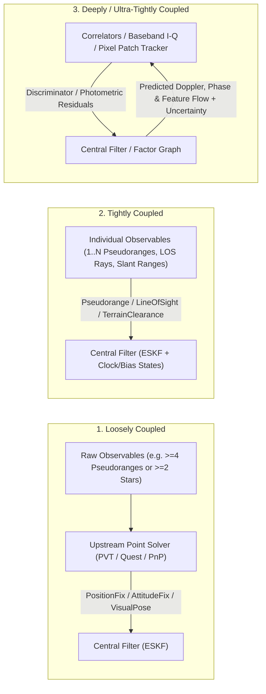

# Chapter 8: Coupling Paradigms: Loose, Tight, and Deep Integration

Multi-sensor navigation architectures are classified by the level at which external sensor data enters the central state estimator. Choosing the coupling level is one of the most important architectural decisions in navigation system design. It governs observability under partial sensor outages, statistical independence of measurement errors, and software modularity.

This chapter defines the taxonomy of **loosely coupled**, **tightly coupled**, and **deeply (or ultra-tightly) coupled** navigation, documents the loose and tight architectures implemented in `Navigate` today, and specifies the architectural seams reserved for future tight and deep coupling extensions.

## Technical names

- **Loosely coupled integration** fuses position, velocity, or attitude solutions computed by a dedicated upstream sensor solver with a central navigation filter.
- **Tightly coupled integration** bypasses the upstream position/attitude solver and feeds individual sensor observables (such as pseudoranges, range rates, star lines of sight, or slant ranges) directly into the central filter's measurement models.
- **Deeply coupled (ultra-tight) integration** closes the loop from the central navigation filter and its covariance back into the physical signal-processing or pixel-tracking loops of the sensor hardware or front-end.

## Comparison of coupling levels

| Property | Loosely coupled | Tightly coupled | Deeply / ultra-tightly coupled |
|---|---|---|---|
| **Minimum observables per epoch** | Must overdetermine the full local sub-problem (e.g., $\ge 4$ GNSS satellites, $\ge 2$ stars, $\ge 4$ 3D-2D visual points) | Operates with **a single observable** (e.g., 1 satellite pseudorange, 1 star line of sight, 1 laser slant range) | Operates below the single-channel lock threshold by pooling carrier/pixel SNR across time |
| **Error correlation risk** | High: upstream solver outputs have cross-correlated axes and time-correlated errors if the upstream module uses its own filter | Low: individual observables have independent scalar or 2D measurement noise $\mathbf{R}$ when clock and bias states are in the central filter | Lowest, provided process and discriminator noise bandwidths are matched |
| **Required central filter states** | Kinematic states $(\mathbf{p}, \mathbf{v}, \mathbf{q})$ and IMU biases | Adds sensor nuisance states: receiver clock $(c\delta t, c\delta\dot{t})$, altimeter bias $b_{\text{alt}}$, map bias $b_{\text{mag}}$ | Adds signal-tracking or multi-frame keyframe/landmark states |
| **Modularity** | Highest: sensor vendor black-box outputs plug in directly | High in `Navigate`: each observable is a variant of `ObservationValue` (ADR-0008) | Requires tight co-design of the signal/image front-end and the estimator |

## Loosely coupled modalities in `Navigate`

Loosely coupled updates remain valuable when a sensor subsystem solves a complex combinatorial or geometric sub-problem before fusion:

1. **GNSS PVT fixes (`ObservationValue::PositionFix`, `VelocityFix`, `CartesianPositionFix`, `CartesianVelocityFix`)**:
   Used when an external GNSS receiver outputs a solved geodetic or ECEF position and velocity.
2. **6-DOF Visual Pose (`ObservationValue::VisualPose`)**:
   In `navigate-visual`, matching hundreds of 2D image keypoints against a 3D terrain mesh requires robust outlier rejection (`solve_pose_l1_gnc` and `MaskAwareSpatialHoldout`). Once the geometric solver eliminates outliers, `fusion_bridge` packages the verified 6-DOF camera pose into a single `VisualPose` update with a declared map and calibration error budget (ADR-0007, ADR-0020).
3. **Local Attitude Fix (`ObservationValue::AttitudeFix`)**:
   Applies a 3-DOF orientation measurement on the $SO(3)$ manifold via the chart residual $2\log(\mathbf{q}_{\text{nom}}^{-1} \otimes \mathbf{q}_{\text{meas}})$.

### Guarding against loose-coupling hazards

When using loosely coupled updates, `Navigate` enforces three safeguards:

- **Full $3\times 3$ block covariances (`SymmetricCov3`)**: Position and velocity fixes carry full symmetric $3\times 3$ covariance matrices rather than diagonal variances, preserving dilution-of-precision (DOP) geometry.
- **No cascaded filters in the visual localizer**: `navigate_visual::Localizer` is a memoryless single-epoch solver. When `FlightVisualEngine` uses relative odometry between anchors, it propagates the error budget explicitly rather than running a hidden secondary Kalman filter.
- **Prior exclusion (ADR-0009)**: The navigation state narrows the visual candidate search area, but the prior never enters the PnP cost function.

## Tightly coupled modalities in `Navigate`

`Navigate` implements tight coupling across radiometric, celestial, optical, terrain, and magnetic domains by adding the necessary nuisance states to the 22-state `InertialNavigationFilter` (ADR-0008, ADR-0012, ADR-0014, ADR-0018, ADR-0021):

1. **Radiometric one-way and two-way ranging (`Pseudorange`, `PseudorangeRate`, `TwoWayRange`, `TwoWayRangeRate`)**:
   Instead of requiring four simultaneous satellites to solve for $(\mathbf{p}, c\delta t)$, the filter estimates receiver clock bias $c\delta t$ (state 20) and drift $c\delta\dot{t}$ (state 21) directly. Even one or two visible satellites or lunar surface beacons constrain the trajectory along their line-of-sight vectors $\mathbf{u}^\top$.
2. **Star sightings and optical navigation (`LineOfSight`)**:
   In `navigate-startrack`, converting star sightings to a local NED `AttitudeFix` requires knowing the vehicle's latitude and longitude, which introduces circular correlation with the filter's position estimate (ADR-0021). Instead, `line_of_sight_observations` emits each identified star as an independent 2-DOF `ObservationValue::LineOfSight` in ECEF axes. Even a **single star** constrains two attitude axes, and coupling with the gravity vector in the inertial mechanization bounds position drift (astro-inertial navigation). For planetary targets (`LineOfSightReference::TargetPosition`), the same 2-DOF tangent-plane residual simultaneously updates attitude ($\mathbf{B}^\top[\hat{\mathbf{u}}_b\times]$) and position ($-\mathbf{B}^\top\mathbf{C}^\top/\|\mathbf{d}\|$).
3. **Slant-range terrain clearance (`TerrainClearance`)**:
   Instead of assuming a vertical nadir beam over flat ground, the `TerrainClearance` measurement model couples ellipsoidal height $h$, terrain elevation $T_0$, terrain north/east slope $[s_N, s_E]$, and body attitude $\mathbf{C}_{bl}$ along the body-fixed beam vector $\mathbf{b}$.
4. **Linearized magnetic anomaly (`MagneticAnomaly`)**:
   Couples horizontal position with the scalar map gradient $\mathbf{g}$ and estimates the per-map-release bias state $b_{\text{mag}}$ (state 16).

---

## Reserved seams for future tight and deep coupling

The type boundaries and propagator seams of `Navigate` are designed so that deeper coupling paradigms can join without breaking existing contracts. Below is the roadmap and mathematical architecture for those extensions.

### 1. Carrier-phase GNSS (RTK / PPP) and ARAIM protection levels

- **Physical problem:** Code pseudoranges have meter-level noise and multipath error. Carrier-phase measurements $\Phi_L = \|\mathbf{p} - \mathbf{p}^s\| + c\delta t - I_L + T + \lambda_L N_L + \epsilon_\Phi$ have millimeter noise but include an unknown integer cycle ambiguity $N_L \in \mathbb{Z}$.
- **Tight-coupling extension:** A future carrier-phase module extends the state or uses a marginalized float-ambiguity bank to estimate double-differenced (RTK) or undifferenced (PPP) ambiguities, followed by Least-squares AMBiguity Decorrelation Adjustment (LAMBDA) integer fixing.
- **Integrity seam:** `IntegrityAssessment::protection_levels` (`Option<ProtectionLevels>`) is already reserved in `navigate-contract` (ADR-0004) to carry Horizontal and Vertical Protection Levels (HPL / VPL) computed via Multiple Hypothesis Solution Separation (MHSS) RAIM / ARAIM over tightly coupled pseudorange and carrier subsets.

### 2. Tightly coupled Visual-Inertial Odometry (MSCKF / Sliding-Window Bundle Adjustment)

- **Physical problem:** In texture-poor or unmapped environments, a camera tracks 2D feature points across $K$ consecutive frames without a 3D map. Converting frame-to-frame optical flow into a loosely coupled velocity or pose step discards multi-frame parallax constraints.
- **Tight-coupling extension (Multi-State Constraint Kalman Filter — MSCKF):**
  Instead of putting thousands of 3D feature positions into the state vector, the filter augments the state history ring (already present in `navigate-fusion` for OOSM!) with $K$ cloned camera poses $\{\mathbf{q}_{c_i}, \mathbf{p}_{c_i}\}_{i=1}^K$. When a tracked 2D feature leaves the field of view, a Gauss–Newton triangulation estimates its 3D position $\hat{\mathbf{p}}_f$, and nullspace projection ($\mathbf{H}_f^\perp$) marginalizes $\delta\mathbf{p}_f$ out of the stacked reprojection residuals:

  $$\mathbf{r}_o = \mathbf{N}^\top \mathbf{r} \approx \mathbf{N}^\top \mathbf{H}_x \delta\mathbf{x}_{\text{poses}} + \mathbf{N}^\top \mathbf{n}, \qquad \mathbf{N}^\top \mathbf{H}_f = \mathbf{0}$$

  This nullspace residual directly updates the inertial state and the historical camera poses without ever storing 3D landmarks in the permanent state vector.

### 3. Deep / Ultra-Tight coupling: INS-aided signal tracking and direct photometric/centroid fusion

In high-dynamics flight, heavy jamming, or rapid angular slewing, the front-end sensor detector fails before it can produce even a tightly coupled observable:

- **Ultra-tight GNSS (Vector Tracking / INS-Aided Baseband):**
  In a conventional receiver, each satellite tracking channel runs an independent Phase Lock Loop (PLL) and Delay Lock Loop (DLL). Under high $g$-loads or jamming, wide loop bandwidths admit excessive thermal noise and lose lock. In ultra-tight coupling, the central `InertialNavigationFilter` predicts the exact pseudorange and Doppler shift for every satellite at the IMU rate. The receiver correlators require only a narrow noise bandwidth to track the residual clock drift, or feed raw In-Phase and Quadrature ($I/Q$) correlator outputs directly into the navigation filter discriminator.
- **Direct Astro-Inertial Centroid / Streak Coupling:**
  Under high angular rates or dim star fields, `navigate-startrack` already uses the host's `AttitudePrior` to project the `flamsteed` catalog onto the focal plane and uses the IMU exposure duration to model star streaks (ADR-0021). The deep-coupling extension uses the inertial filter's instantaneous angular velocity $\tilde{\boldsymbol{\omega}}_b(t)$ over the exposure window to construct a matched spatial-temporal point-spread template, extracting sub-pixel star lines of sight at signal-to-noise ratios below the standalone detection threshold.
- **Direct Photometric / Thermal Map Alignment:**
  In low-contrast LWIR thermal imagery where sparse keypoint detectors (`XFeat`) find few corners, deep coupling bypasses discrete keypoint extraction and minimizes the normalized mutual information or dense feature-metric residual directly against the state covariance ellipsoid of the central filter.
