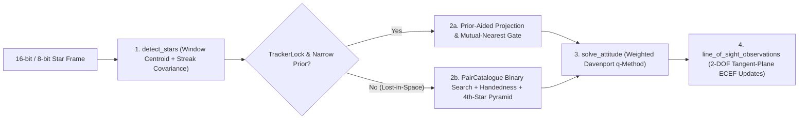

# Chapter 11: Star Tracking and Astro-Inertial Navigation

A star tracker is an optical camera that images the night (or daytime high-altitude) sky, detects star centroids, identifies the stars against an onboard catalog, and determines spacecraft or aircraft attitude to arcsecond precision. When tightly coupled with an IMU and a gravity field model, star sightings also bound horizontal position drift—a classical discipline known as **astro-inertial navigation**. `navigate-camera` and `navigate-startrack` implement the complete star-tracking and astro-inertial observation pipeline (ADR-0021).

## Technical names

- **Centroiding** is the sub-pixel estimation of a star's center of light on an image sensor, together with its noise covariance matrix.
- **Lost-in-space (LIS) identification** is the matching of observed image centroids to catalog stars using only inter-star angles, without any prior attitude estimate.
- **Pyramid identification** is a four-star geometric matching algorithm that verifies a base star triangle with a fourth confirming star to eliminate false matches.
- **Astro-inertial coupling** is the observability of vehicle position from inertial star lines of sight combined with accelerometer gravity sensing.

## 1. The physical problem: Breaking the position-attitude circularity

On a planetary surface, the local NED reference frame depends on the vehicle's geodetic latitude $\varphi$ and longitude $\lambda$. A star camera, however, measures the rotation from body FRD axes to inertial or ECEF axes ($\mathbf{C}_b^e$).

If an adapter converts the star camera attitude $\mathbf{C}_b^e$ into a local NED `ObservationValue::AttitudeFix` ($\mathbf{C}_b^{\text{NED}} = \mathbf{C}_e^{\text{NED}}(\hat{\varphi}, \hat{\lambda})\,\mathbf{C}_b^e$), the adapter must use the filter's own position estimate $(\hat{\varphi}, \hat{\lambda})$:

1. Any error in the filter's position estimate $\delta\mathbf{p}$ corrupts the supposedly independent `AttitudeFix`, violating correlation discipline (Chapter 3).
2. Even worse, pre-multiplying by $\mathbf{C}_e^{\text{NED}}(\hat{\varphi}, \hat{\lambda})$ cancels the physical relationship between the star direction and the Earth-fixed vertical!

By contrast, when each matched star enters `InertialNavigationFilter` as a tightly coupled `ObservationValue::LineOfSight` in ECEF axes (`LineOfSightReference::InertialDirection`):

- The measurement requires **no vehicle position** and remains 100% statistically independent.
- In `InertialNavigationFilter`, the star sighting locks the body attitude $\mathbf{C}_b^e$ in ECEF axes. Because the accelerometers measure $\mathbf{f}_b \approx -\mathbf{C}_e^b \mathbf{g}(\mathbf{p})$, and the direction of gravity $\mathbf{g}(\mathbf{p})$ rotates by $1''$ for every $30.9\text{ m}$ on the Earth's surface, the velocity error dynamics $\delta\dot{\mathbf{v}} = (\partial\mathbf{g}/\partial\mathbf{p})\delta\mathbf{p} - \mathbf{C}_b^e[\tilde{\mathbf{f}}_b\times]\delta\boldsymbol{\theta}$ couple attitude and position. Inertial star lines of sight plus accelerometers make **position observable without GNSS**!

## 2. Mathematical formulation (`navigate-startrack`)

The pipeline processes one `navigate_camera::ImageFrame` in four deterministic stages:

### Stage 1: Radiometric centroiding and rotational streak covariance (`detect_stars`)

`detect_stars` identifies connected pixel groups above the local background (dropping groups that touch the image border). Within a fixed window around each peak, let $I_k$ be the background-subtracted intensity at pixel $\mathbf{x}_k = [u_k, v_k]^\top$ and $S = \sum_k I_k$. The intensity-weighted centroid is:

$$\hat{\mathbf{c}} = \frac{1}{S}\sum_k I_k \mathbf{x}_k, \qquad \frac{\partial \hat{\mathbf{c}}}{\partial I_k} = \frac{\mathbf{x}_k - \hat{\mathbf{c}}}{S}$$

With per-pixel variance $\sigma_{I,k}^2 = \sigma_{\text{read}}^2 + I_{\text{bg}} + g_{\text{shot}} I_k$, first-order error propagation gives the $2\times 2$ pixel covariance:

$$\boldsymbol{\Sigma}_{\mathbf{c}} = \frac{1}{S^2}\sum_k \sigma_{I,k}^2 (\mathbf{x}_k - \hat{\mathbf{c}})(\mathbf{x}_k - \hat{\mathbf{c}})^\top$$

When the vehicle rotates during the exposure interval, each star forms an elongated streak on the sensor. The centroid of the streak corresponds to the star direction at the **mid-exposure instant**, and $\boldsymbol{\Sigma}_{\mathbf{c}}$ is naturally larger along the streak axis than across it.

### Stage 2: Star identification (`identify_stars`)

- **Prior-aided mode (`IdentifyMode::Prior`)**: Projects the `navigate-celestial` catalog through the `AttitudePrior`, requires mutual nearest-neighbor uniqueness within an angular gate, and verifies all pairwise inter-star angles.
- **Lost-in-Space mode (`IdentifyMode::LostInSpace`)**: Uses a precomputed `PairCatalogue` of catalog star pairs within the camera field of view, sorted by inter-star angle. For a triad of bright centroids $(i, j, k)$:
  1. Binary searches `PairCatalogue` for catalog pairs matching angles $\theta_{ij}, \theta_{jk}, \theta_{ik}$ within tolerance.
  2. Checks 3D triangle handedness ($\det[\mathbf{u}_i, \mathbf{u}_j, \mathbf{u}_k]$ sign) to reject mirror-image asterisms.
  3. Requires a fourth centroid $m$ to confirm a unique catalog pyramid before refining the full frame with the resulting attitude prior.

### Stage 3: Weighted Davenport q-method (`solve_attitude`)

Given $N$ matched body unit vectors $\mathbf{b}_i$ and ECEF reference unit vectors $\mathbf{r}_i$ with weights $w_i = 1/\sigma_i^2$, `solve_attitude` constructs the $4\times 4$ Davenport matrix $\mathbf{K}$ from $\mathbf{B} = \sum w_i \mathbf{b}_i \mathbf{r}_i^\top$. The eigenvector of $\mathbf{K}$ with the largest eigenvalue is the optimal unit quaternion $\hat{\mathbf{q}}_b^e$. The $3\times 3$ attitude covariance retains the anisotropic centroid covariance $\boldsymbol{\Sigma}_{\mathbf{c},i}$ projected through the pinhole and lens-distortion Jacobian.

### Stage 4: 2-DOF tangent-plane `LineOfSight` measurement model

In `InertialNavigationFilter`, a 3D unit vector $\mathbf{u}_b$ has only two degrees of freedom; a $3\times 3$ covariance would be rank-deficient. Given the predicted direction $\hat{\mathbf{u}}_b = \hat{\mathbf{C}}_f^b \mathbf{r}_f$, the filter constructs a $3\times 2$ orthonormal basis $\mathbf{B} = [\mathbf{e}_1, \mathbf{e}_2]$ spanning the plane orthogonal to $\hat{\mathbf{u}}_b$:

$$\mathbf{y} = \mathbf{B}^\top \mathbf{u}_{b,\text{meas}} \in \mathbb{R}^2, \qquad \mathbf{H}_{\theta} = \mathbf{B}^\top [\hat{\mathbf{u}}_b\times] \in \mathbb{R}^{2\times 3}, \qquad \mathbf{R} = \sigma^2 \mathbf{I}_2$$

## 3. Pathologies, integrity, and mode switching (`StarTracker`)

If the filter's attitude prior drifts during a cloud outage, a naive prior-aided tracker never recovers because true stars fall outside its projection gate. `StarTracker` prevents prior lock-out with automatic mode switching: it uses `IdentifyMode::Prior` only while holding a valid lock (`TrackerLock`) with a narrow prior radius, and drops back to `IdentifyMode::LostInSpace` at startup, whenever the prior exceeds `max_prior_radius_rad`, or after `max_lost_frames` consecutive failed frames.

## 4. Implementation in `Navigate`

- `navigate-camera`: `Intrinsics`, `Distortion` (Brown–Conrady 3 radial + 2 tangential), `CameraMount`, `ImagerModel`, `ImageView`.
- `navigate-startrack`: `detect_stars`, `PairCatalogue`, `identify_stars`, `solve_attitude`, `StarTracker`, `line_of_sight_observations`, and `attitude_fix_local_ned`.
