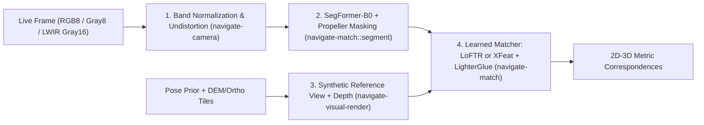

# Chapter 12: Visual and Thermal Terrain-Relative Navigation I: Sensing, Rendering, and Matching

Terrain-Relative Navigation (TRN) determines absolute vehicle position and attitude by comparing downward or oblique camera frames against onboard digital elevation models (DEMs) and orthoimagery. Unlike GNSS, optical TRN is completely passive and immune to radio-frequency jamming. However, seasonal appearance changes, shadows, clouds, airframe obstructions, and night operations defeat classical corner detectors (such as HARRIS or ORB).

`Navigate` solves the sensing, rendering, masking, and learned matching stages of TRN across `navigate-camera`, `navigate-visual-render`, `navigate-match`, and `navigate-match-kernels` (ADR-0010, ADR-0011, ADR-0020, ADR-0021).

## Technical names

- **Reference view** (`ReferenceView`) is a synthetic grayscale image and per-pixel metric depth buffer rendered from a 3D terrain mesh and orthoimagery at a candidate camera pose.
- **Valid-pixel mask** is a binary or class mask that zeroes out non-terrain pixels (sky, water, clouds, airframe, and spinning propellers) before feature extraction.
- **Detector-free matching** (`LoFTR`) matches dense image grids with self- and cross-attention transformers without requiring discrete keypoint corners.
- **Sparse learned matching** (`XFeat` + `LighterGlue`) extracts lightweight CNN keypoints and descriptors (`XFeat`) and matches them with an adaptive early-exit graph transformer (`LighterGlue`).

## 1. The physical problem: Day/night appearance invariance, weather, and occlusions

To match a live airborne or spacecraft frame against a satellite reference map, the front-end pipeline must account for five physical and environmental factors:

1. **Weather and surface unavailability:** Overcast cloud decks below the vehicle, fog, heavy rain, snow-covered plains, and open water obscure or erase ground texture. In LWIR thermal imagery, prolonged rain or diurnal thermal crossover reduces ground emissivity contrast to near zero. When valid ground pixels or feature matches fall below minimum thresholds, the pipeline must reject the frame cleanly rather than emit a false fix.
2. **Perspective and terrain relief distortion:** An oblique camera looking at mountainous terrain sees foreshortened slopes and occluded valleys that differ from a nadir satellite map.
3. **Dynamic occluders:** An aircraft camera often sees the nose cone, wing struts, or a spinning propeller in the lower field of view, and sky or clouds above the horizon. Matching airframe pixels across frames biases visual odometry toward zero motion; matching clouds to ground texture produces gross position outliers.
4. **Spectral shift (Visible vs. LWIR thermal):** At night, a Long-Wave Infrared (LWIR, $8\text{–}14\,\mu\text{m}$) sensor records 16-bit thermal radiance counts (`Pixels::Gray16`). Thermal contrast can reverse between day and night.
5. **Hardware heterogeneity:** The same matching code must run deterministically on embedded NPUs, native GPUs (Vulkan, Metal, CUDA), and browser WebGPU/WebNN workers.

## 2. Mathematical and algorithmic pipeline

### Stage 1: Unified sensor normalization and LWIR thermal AGC (`navigate-camera`)

`navigate-camera::ImagerModel` unifies visible (`SpectralBand::Visible`), near-infrared (`NearInfrared`), and thermal (`LongWaveInfrared`) sensors. For 16-bit LWIR frames, `ImageView::to_gray8_percentile` applies a deterministic percentile automatic gain control (AGC) stretch that maps raw thermal counts into 8-bit dynamic range as a pure function of the image histogram (ADR-0021).

### Stage 2: Reference view synthesis (`navigate-visual-render`)

Instead of warping the live oblique image onto a flat plane (which fails over 3D terrain relief), `navigate-visual-render` projects the 3D terrain mesh and orthoimagery tiles into the camera's exact `CameraModel` at the prior pose on CPU or `wgpu` GPU (ADR-0010). The renderer outputs both a synthetic image $I_{\text{ref}}(u, v)$ and an exact metric ray depth map $D_{\text{ref}}(u, v)$ in meters. Consequently, every matched reference pixel $(u_r, v_r)$ lifts immediately to a 3D world point $\mathbf{P}_i \in \mathbb{R}^3$.

### Stage 3: Semantic occlusion and propeller masking (`navigate-match::segment`)

For visible-band frames, `navigate-match::segment` runs a 4-class `SegFormer-B0` (`[Xie2021]`) hierarchical vision transformer trained in pure Rust on `burn`:

- Class `0` (`sky`), Class `2` (`airframe`), and Class `3` (`propeller`) are masked to `0`.
- Only Class `1` (`ground`) pixels (`255`) pass to the feature matcher.
- In real-time flight (`navigate-visual-flight::AmortizedMasker`), the engine runs `SegFormer-B0` at a keyframe interval and warps the semantic mask across intermediate frames using inter-frame homographies, combined with a high-rate propeller motion detector.
- For LWIR night frames (or when median luma falls below `NIGHT_BYPASS_LUMA_P50`), the engine bypasses the visible-color sky network and retains the static airframe and propeller masks (ADR-0021).

### Stage 4: Learned correspondence (`LoFTR`, `XFeat`, `LighterGlue`, `DINOv2`)

`navigate-match` implements four neural architectures in pure Rust on `burn` (with custom GPU kernels in `navigate-match-kernels` on CubeCL and optional ONNX Runtime execution via `ort`):

| Model | Role in `Navigate` | Key algorithmic properties |
|---|---|---|
| `LoFTR` (`[Sun2021]`) | High-accuracy detector-free dense matching | Coarse $1/8$-scale ResNet + Linear Transformer self/cross-attention, followed by $1/2$-scale correlation refinement |
| `XFeat` (`[Potje2024]`) | High-speed sparse keypoint & descriptor extraction | Featherweight CNN architecture designed for real-time 30 Hz flight corridor tracking (`XFeatRuntime`) |
| `LighterGlue` (`[Lindenberger2023]`) | Learned sparse graph matching | Attentional graph neural network over `XFeat` keypoints with adaptive token bucketing (`StaticMatcherShape`) and confidence early exit |
| `Dinov2` (`[Oquab2024]`) | Coarse global place recognition | ViT-S/14 vision transformer whose patch and CLS tokens index large geographic regions in `navigate-locate::place` |

### Stage 5: Precomputed Kashin reference banks (`navigate-match::kashin`)

To avoid rendering and extracting features from reference tiles on the fly during a mission along a planned corridor, `navigate-match::kashin` precomputes a compact binary reference bank (`NVKBANK1`). Each reference view stores a 160-byte `ViewSketch` summary, 3D terrain coordinates, and 28-byte orthogonal Hadamard-projected `KashinDescriptor` codes. At flight time, `PreparedKashinQuery` screens thousands of reference views in microseconds before running `LighterGlue` refinement.
