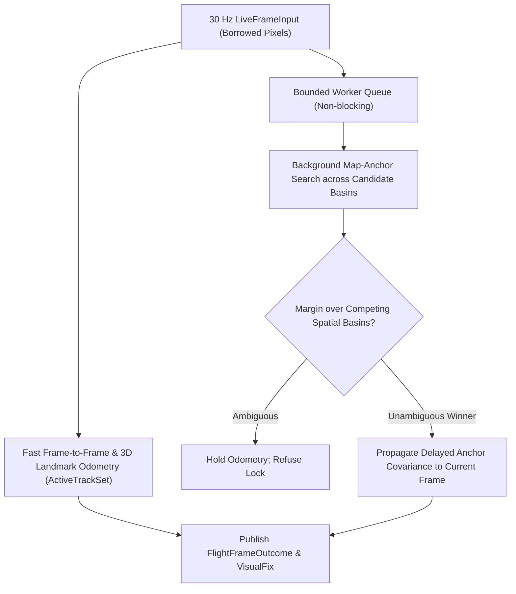

# Chapter 13: Visual and Thermal Terrain-Relative Navigation II: Pose Solving, Corridor Tracking, and Fusion

Once the visual front-end matches 2D live image coordinates $\mathbf{u}_i$ to 3D reference map points $\mathbf{P}_i$, the geometric back-end must solve for the 6-DOF camera pose $(\mathbf{R}, \mathbf{t})$, reject repetitive-texture false locks, track continuous motion at 30 Hz, and inject properly budgeted observations into `InertialNavigationFilter`. `navigate-visual`, `navigate-locate`, and `navigate-visual-flight` implement this back-end (ADR-0007, ADR-0009, ADR-0020).

## Technical names

- **Graduated Non-Convexity (`L1-GNC`)** is a deterministic robust optimization scheme that solves outlier-contaminated Perspective-n-Point (PnP) problems without random RANSAC sampling.
- **Spatial holdout** (`MaskAwareSpatialHoldout`) is a cross-validation gate that withholds matches in distinct image quadrants during pose fitting and requires the solved pose to predict the withheld quadrants accurately.
- **Competing spatial basins** are two or more geographically separated terrain locations that both yield high feature-matching scores (for example, parallel mountain ridges or repetitive farmland).
- **Fusion bridge** (`navigate_visual::fusion_bridge`) is the single adapter that converts a visual `Estimate` into a `navigate_fusion::Observation` with a declared map and calibration error budget.

## 1. The physical problem: Outliers, pinch degeneracy, and repetitive terrain

Even with learned transformers (`LoFTR` or `LighterGlue`), 20% to 60% of correspondences can be outliers over forests, snow, or water. Worse, two geometric failure modes occur in aerial TRN:

1. **Collinear / pinch degeneracy:** When all matched features lie in a small patch near the center of the image (for example, through a hole in the clouds), the camera position and pitch/roll become nearly unobservable along the viewing ray.
2. **Basin ambiguity:** A single high-inlier pose at candidate A is unsafe if candidate B $2\text{ km}$ away has a similar inlier count.

## 2. Mathematical and algorithmic formulation

### Robust `L1-GNC` PnP and spatial holdout (`navigate-visual::pose_solver`, `holdout_pnp`)

Given 3D reference points $\mathbf{P}_i$ and normalized camera rays $\bar{\mathbf{u}}_i$, `solve_pose_l1_gnc` minimizes the robust reprojection cost over $(\mathbf{R}, \mathbf{t}) \in SE(3)$:

$$\min_{\mathbf{R} \in SO(3),\, \mathbf{t} \in \mathbb{R}^3} \sum_{i=1}^N \rho_\mu\!\left(\|\pi(\mathbf{R}^\top(\mathbf{P}_i - \mathbf{t})) - \bar{\mathbf{u}}_i\|\right)$$

where $\rho_\mu(\cdot)$ is a surrogate penalty parameterized by a continuation parameter $\mu$. Starting from a convex $L_1$/Huber surrogate that admits a global optimum without random seeds, `solve_pose_l1_gnc` gradually tightens $\mu$ via iteratively reweighted Gauss–Newton steps on the $se(3)$ Lie algebra until hard outliers receive zero weight.

To prevent overfitting to a single local cluster of features, `MaskAwareSpatialHoldout` partitions the valid image domain into spatial sectors, fits the pose on training sectors, and verifies reprojection error on held-out sectors. If the matched rays span too narrow a solid angle (`QueryRayDomain`), the solver rejects the frame rather than emitting an ill-conditioned pose.

### Global and regional place search (`navigate-locate::place`)

When the position prior is wide (or absent in single-photo localization), `navigate-locate::place` searches a Hilbert-curve spatially sharded index of `DINOv2` place descriptors. Candidate regions are ranked, rendered, and verified through `PairLocalizer` or `FeatureLocalizer`.

### Real-time 30 Hz flight corridor engine (`navigate-visual-flight`)

`FlightVisualEngine` processes borrowed `LiveFrameInput` pixel buffers at 30 Hz with zero disk I/O:

- **Foreground tracking:** Tracks 3D corridor landmarks (`CorridorLandmarkBank`) and optical flow (`DualPathDeadReckoner`) within a deterministic millisecond budget.
- **Background map-anchor verification:** Asynchronous workers search candidate map tiles. Before accepting an anchor lock, the engine checks the score ratio and spatial separation between the best basin and the second-best competing basin.

## 3. Entering the fusion filter (`fusion_bridge`)

The visual covariance $\boldsymbol{\Sigma}_{\text{geom}}$ from PnP reflects only pixel noise and ray geometry; it does **not** include DEM registration errors, orthophoto rectification shifts, or camera-to-IMU mount misalignment (ADR-0007).

`navigate_visual::fusion_bridge` transforms the pose from its `LocalFrame` (Web Mercator up to $85^\circ$ latitude, or pole-free `LocalFrame::BodyTangentEnu` at all latitudes up to $90^\circ$ on the Earth, the Moon, and Mars, ADR-0020) into the body-fixed frame of the planet and inflates the covariance with the declared map and mount error budgets:

$$\boldsymbol{\Sigma}_{\text{total}} = \boldsymbol{\Sigma}_{\text{geom}} + \boldsymbol{\Sigma}_{\text{map}} + \boldsymbol{\Sigma}_{\text{mount}}$$

The bridge emits either:

1. A 3-DOF `ObservationValue::PositionFix` for the 6-state `NavigationFilter` or 22-state `InertialNavigationFilter`, or
2. A 6-DOF `ObservationValue::VisualPose` (position in frame axes + body attitude in local NED axes), which `InertialNavigationFilter` fuses as a single 6-dimensional update gated by `FusionConfig::pose_gate_chi2`.
