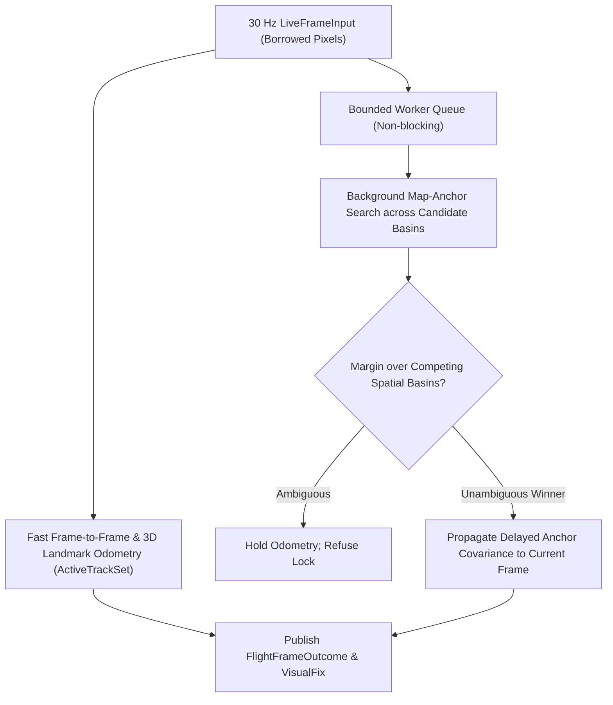

# Chapter 13: Visual and Thermal Terrain-Relative Navigation II: Pose Solving, Corridor Tracking, and Fusion

Once the visual front-end matches 2D live image coordinates $\mathbf{u}_i$ to 3D reference map points $\mathbf{P}_i$, the geometric back-end must solve for the 6-DOF camera pose $(\mathbf{R}, \mathbf{t})$, reject repetitive-texture false locks, track continuous motion at 30 Hz, and inject properly budgeted observations into `InertialNavigationFilter`. `navigate-visual`, `navigate-locate`, and `navigate-visual-flight` implement this back-end (ADR-0007, ADR-0009, ADR-0020).

## Technical names

- **Graduated Non-Convexity (`L1-GNC`)** is a deterministic robust optimization scheme that solves outlier-contaminated Perspective-n-Point (PnP) problems without random RANSAC sampling.
- **Spatial holdout** (`MaskAwareSpatialHoldout`) is a cross-validation gate that withholds matches in distinct image quadrants during pose fitting and requires the solved pose to predict the withheld quadrants accurately.
- **Competing spatial basins** are two or more geographically separated terrain locations that both yield high feature-matching scores (for example, parallel mountain ridges or repetitive farmland).
- **Fusion bridge** (`navigate_visual::fusion_bridge`) is the single adapter that converts a visual `Estimate` into a `navigate_fusion::Observation` with a declared map and calibration error budget.

## 1. The physical problem: Outliers, pinch degeneracy, and repetitive terrain

Even with learned transformers (`LoFTR` or `LighterGlue`), 20% to 60% of correspondences can be outliers over forests, snow, or water. Worse, two geometric failure modes occur in aerial TRN:

1. **Collinear / pinch degeneracy:** When all matched features lie in a small patch near the center of the image (for example, through a hole in the clouds), the camera position and pitch/roll become nearly unobservable along the viewing ray.
2. **Basin ambiguity:** A single high-inlier pose at candidate A is unsafe if candidate B $2\text{ km}$ away has a similar inlier count.

## 2. Mathematical and algorithmic formulation

### Robust `L1-GNC` PnP and spatial holdout (`navigate-visual::pose_solver`, `holdout_pnp`)

Given 3D reference points $\mathbf{P}_i$ and normalized camera rays $\bar{\mathbf{u}}_i$, `solve_pose_l1_gnc` minimizes the robust reprojection cost over $(\mathbf{R}, \mathbf{t}) \in SE(3)$ (`[Yang2020]`):

$$\min_{\mathbf{R} \in SO(3),\, \mathbf{t} \in \mathbb{R}^3} \sum_{i=1}^N \rho_\mu\!\left(\|\pi(\mathbf{R}^\top(\mathbf{P}_i - \mathbf{t})) - \bar{\mathbf{u}}_i\|\right)$$

where $\rho_\mu(\cdot)$ is a surrogate penalty parameterized by a continuation parameter $\mu$. Because perspective projection over $(\mathbf{R}, \mathbf{t}) \in SE(3)$ is non-convex, a residual-convex loss does not guarantee a global optimum over arbitrary attitudes. Instead, `solve_pose_l1_gnc` initializes at a bounded `PosePrior` (whose uncertainty lies within the convergence basin of the local tangent linearization) and executes a two-stage deterministic schedule without random RANSAC sampling:

1. **Stage 1 (Smoothed-$L_1$ IRLS, `WeightKernel::L1`):** Runs iteratively reweighted Gauss–Newton updates on $\mathfrak{se}(3)$ with the residual-convex smoothed-$L_1$ weight $w_i = 1 / \sqrt{r_i^2 + \epsilon^2}$ to pull the pose toward the inlier consensus from the `PosePrior`.
2. **Stage 2 (Graduated Non-Convexity, `WeightKernel::Gnc` and `WeightKernel::Tls`):** Tightens the continuation parameter $\mu$ across outer iterations until residuals above the truncated least-squares threshold receive exact zero weight, while enforcing bounded rotation and translation gates relative to `PosePrior`.

To prevent overfitting to a single local cluster of features, `MaskAwareSpatialHoldout` partitions the valid image domain into spatial sectors, fits the pose on training sectors, and verifies reprojection error on held-out sectors. If the matched rays span too narrow a solid angle (`QueryRayDomain`), the solver rejects the frame rather than emitting an ill-conditioned pose.

### Global and regional place search (`navigate-locate::place`)

When the position prior is wide (or absent in single-photo localization), `navigate-locate::place` searches a Hilbert-curve spatially sharded index of `DINOv2` place descriptors. Candidate regions are ranked, rendered, and verified through `PairLocalizer` or `FeatureLocalizer`.

### Real-time 30 Hz flight corridor engine (`navigate-visual-flight`)

`FlightVisualEngine` processes borrowed `LiveFrameInput` pixel buffers at 30 Hz with zero disk I/O:

- **Foreground tracking:** Tracks 3D corridor landmarks (`CorridorLandmarkBank`) and optical flow (`DualPathDeadReckoner`) within a deterministic millisecond budget.
- **Background map-anchor verification:** Asynchronous workers search candidate map tiles. Before accepting an anchor lock, the engine checks the score ratio and spatial separation between the best basin and the second-best competing basin.

## 3. Entering the fusion filter (`fusion_bridge`)

The visual covariance $\boldsymbol{\Sigma}_{\text{solver}}$ from PnP reflects only pixel noise and ray geometry; it does **not** include DEM registration errors, orthophoto rectification shifts, or camera-to-IMU mount misalignment (ADR-0007).

Because systematic errors—horizontal map registration $e_{\text{map},h}$, vertical DEM datum error $e_{\text{map},v}$, mount calibration $e_{\text{cal}}$, projection geometry approximation $e_{\text{geom}}$, and tie-point disparity $e_{\text{disp}}$—are coherent and can correlate constructively, summing their variances directly would underestimate the true error when biases align. Instead, `VisualErrorBudget::variances_m2` bounds the systematic budget in the local tangent frame (`LocalFrame`) using the **squared sum of RMS allowances** (the worst-case positive correlation bound):

$$\sigma_{h,\text{budget}}^2 = \left(e_{\text{map},h} + e_{\text{cal}} + e_{\text{geom}} + e_{\text{disp}}\right)^2, \qquad \sigma_{v,\text{budget}}^2 = \left(e_{\text{map},v} + e_{\text{cal}} + e_{\text{geom}} + e_{\text{disp}}\right)^2$$

In the common local tangent frame (Web Mercator up to $85^\circ$ latitude, or pole-free `LocalFrame::BodyTangentEnu` up to $90^\circ$ on the Earth, the Moon, and Mars, ADR-0020), `navigate_visual::fusion_bridge` adds $\boldsymbol{\Sigma}_{\text{budget}} = \operatorname{diag}(\sigma_{h,\text{budget}}^2, \sigma_{h,\text{budget}}^2, \sigma_{v,\text{budget}}^2)$ to the solver's geometric covariance $\boldsymbol{\Sigma}_{\text{solver}}$ and maps the combined covariance into the planet-fixed frame via the frame Jacobian $\mathbf{J}$:

$$\boldsymbol{\Sigma}_{\text{frame}} = \mathbf{J}\left(\boldsymbol{\Sigma}_{\text{solver}} + \boldsymbol{\Sigma}_{\text{budget}}\right)\mathbf{J}^\top$$

To limit temporal autocorrelation when the aircraft views the same terrain patch across consecutive frames, `EvidenceIndependence` tracks spatial cell visitation and baseline travel before crediting independent visual fixes.

The bridge emits either:

1. A 3-DOF `ObservationValue::PositionFix` for the 6-state `NavigationFilter` or 22-state `InertialNavigationFilter`, or
2. A 6-DOF `ObservationValue::VisualPose` (position in frame axes + body attitude in local NED axes), which `InertialNavigationFilter` fuses as a single 6-dimensional update gated by `FusionConfig::pose_gate_chi2`.
