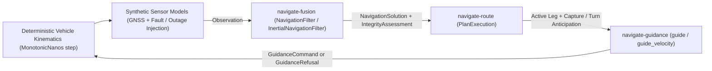

# Chapter 19: Deterministic Closed-Loop Verification (`navrun`)

Unit tests verify individual equations in isolation, but integration failures often emerge at the seams between sensor fusion, integrity assessment, route sequencing, and guidance setpoint generation. `tools/navrun` is the deterministic closed-loop scenario runner that tests the complete `Navigate` loop from end to end.

## Technical names

- **Closed-loop scenario** is a deterministic simulation in which guidance setpoints drive a simulated vehicle state, synthetic sensors generate stamped `Observation`s from that state, and the filter's output feeds back into route execution and guidance.
- **Bit-identical replay** is the guarantee that running the same scenario script on the same target architecture and toolchain (or across bare-metal `#![no_std]` targets using the software `libm` transcendental backend with identical IEEE 754 rounding and no hardware FMA contraction differences) produces bitwise-identical floating-point trajectories, rejection counters, and sequence events, while cross-OS `std` builds agree within tight floating-point tolerances (Chapter 3).

## Architecture of `navrun`

`navrun` links `navigate-contract`, `navigate-geodesy`, `navigate-fusion`, `navigate-route`, and `navigate-guidance` without external I/O or wall-clock dependencies:



Each simulation step advances a monotonic clock `now: MonotonicNanos` by a fixed step $\Delta t$ and checks five system invariants:

1. **Cold start and single-source honesty:** Before sufficient independent sources arrive, the published solution reflects exact single-source redundancy.
2. **Admission gate rejection accounting:** Injected stale, regressed, or outlier observations increment `RejectionCounters` without disturbing the trajectory.
3. **Fly-by turn anticipation and leg sequencing:** As the vehicle approaches each waypoint, `PlanExecution` sequences at the gravity-scaled anticipation distance and transitions through all legs to plan completion.
4. **Cross-track convergence:** Under nominal integrity, `guide_velocity` keeps `max_lateral_dev_m` within the scenario tolerance.
5. **Fail-closed refusal under outage:** When aiding observations stop beyond the staleness horizon, integrity degrades and guidance refuses to emit unsafe commands.

## Running `navrun` and the workspace quality gates

Run the scenario runner from the repository root:

```sh
cargo run -p navrun
```

`navrun` logs structured `ScenarioSummary` metrics (`steps_run`, `plan_completed`, `solutions_published`, `observations_rejected`, `max_lateral_dev_m`, `final_quality`, `final_redundancy`, `final_fault_detection`) to `stderr` and exits with code `0` when all assertions pass.

To execute the full repository quality gate—including structure checks, formatting, Clippy lints, bare-metal `#![no_std]` cross-compilation (`thumbv8m.main-none-eabihf` and `riscv32imac-unknown-none-elf`), `wasm32-unknown-unknown` checks, the 5,000-year `eclipse-canon` verification, and documentation checks—run:

```sh
./ci.sh
```
