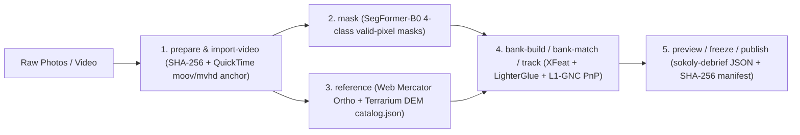

# Chapter 20: Visual Pipeline, Model Conversion, and Web Deployment

Developing, training, and verifying visual terrain-relative navigation (TRN) requires offline tooling to convert neural network checkpoints, prepare geo-referenced photo and video datasets, build precomputed corridor landmark banks, and deploy localization to native and browser runtimes. `Navigate` provides this tooling in pure Rust without Python runtime dependencies: `tools/visual-model`, `tools/visual-pipeline`, `crates/navigate-recording`, and `crates/navigate-locate-web`.

## Technical names

- **Model converter (`navigate-visual-model`)** is the deterministic checkpoint converter that packages `LoFTR`, `XFeat`, and `LighterGlue` weights into `.safetensors` and ONNX artifacts.
- **Reference bank (`NVKBANK1`)** is a binary precomputed corridor file containing rendered terrain views, 3D surface coordinates, 160-byte `ViewSketch` summaries, and 28-byte `KashinDescriptor` codes.
- **Debrief archive (`debrief.json`)** is a `sokoly-debrief` version 1 output archive that records camera poses, inlier correspondences, and trajectory diagnostics for visual inspection.

## 1. Model checkpoint conversion (`tools/visual-model`)

`navigate-visual-model` converts upstream PyTorch or ONNX weights into deterministic `.safetensors` files consumed by the `burn` inference backends in `navigate-match`:

```sh
cargo run --release -p navigate-visual-model -- --help
```

Every converted model artifact is verified against reference tensor outputs so that native CPU, `wgpu` (Metal / Vulkan), CubeCL, and browser WebGPU backends agree within floating-point tolerance.

## 2. Dataset preparation, corridor tracking, and training (`tools/visual-pipeline`)

`navigate-visual-pipeline` drives the end-to-end offline and pre-flight visual workflow:



### Core CLI workflows

1. **Dataset preparation and masking:**
   Run `prepare` to decode images, `priors` to interpolate spherical search priors, `mask` to generate 4-class `SegFormer-B0` occlusion masks (`sky`, `ground`, `airframe`, `propeller`), and `reference` to build a digest-pinned tile `catalog.json`.
2. **Precomputed corridor bank build and real-time match:**
   Run `bank-build` to ray-march terrain views and emit an `NVKBANK1` `.kashin` reference bank. Run `bank-match` with `--lighterglue` and `--polish` to localize flight sequences against the bank at high speed.
3. **In-Rust 4-class semantic segmentation fine-tuning:**
   Run `segment-finetune` to train `SegFormer-B0` directly in Rust on `burn` with differential AdamW learning rates, outputting `model.safetensors` and `training.json`.

## 3. Recording contracts (`navigate-recording`)

`navigate-recording` defines the wire and evidence structures (`Camera`, `Configuration`, `Observation`, `Pose`, `Reference`, `ResultFrame`, `Revisit`) and `Processor` state machine for batch and streaming visual session processing, including revisit loop-closure detection (`RevisitRequest` / `Revisit`).

## 4. Browser WebAssembly deployment (`navigate-locate-web`)

`navigate-locate-web` compiles `navigate-locate` and `navigate-match` to `wasm32-unknown-unknown` for execution inside a browser Web Worker:

- Probes WebNN hardware acceleration (`probe_webnn`) and `burn` WebGPU devices (`open_burn_device`), with automatic CPU fallback.
- Loads `DINOv2` place descriptors to search Hilbert-sharded regional place indices over HTTP (`fetch`), and runs `XFeat` / `LighterGlue` / `LoFTR` pose localization entirely inside client worker memory without uploading user photos to a server.
